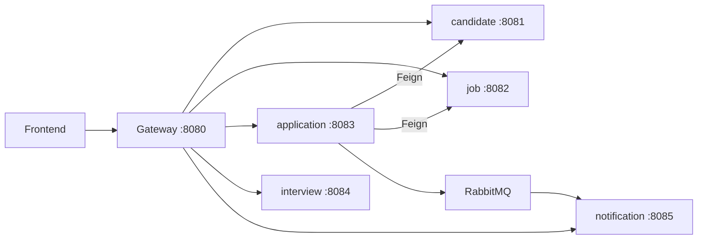

# JobBoard — Microservices (ESPRIT AWD 2026-2027)

> Sujet JobBoard dérivé des monolithes fournis.  
> **Dépôt public** : https://github.com/AzizMehrez/JobBoard-AWD-4SSA8

Plateforme de recrutement découpée en microservices Spring Cloud + un service de notification Python. **Validation 1** : conception + squelettes qui compilent / démarrent — **pas** de logique métier complète.

## Équipe

| Membre | Rôle |
|---|---|
| Mohamed Aziz Mehrez | `ms-candidate` |
| Mohamed Rayen Sboui | `ms-job` |
| Maryem Slatni | `ms-application` |
| Mohamed Ezzedine Zouiten | `ms-interview` |
| Dhia Jbali | `ms-notification` (avancé) |
| **Samer mfarrej** | Plateforme : API Gateway, Eureka, Config Server, Keycloak, Compose |

## Architecture (résumé)

Front → **API Gateway :8080** → services enregistrés dans **Eureka :8761**, config via **Config Server :8888**, auth **Keycloak :8180**, events **RabbitMQ**, **une DB par service**.

Voir `Documentation/Diagrams/architecture.mmd` et `Documentation/05-architecture.md`.



## Structure du dépôt

```text
Backend/                 # microservices + infra + docker-compose
Frontend/                # placeholder README
Documentation/           # dossier conception (FR)
  Diagrams/              # sources Mermaid (.mmd) + SVG
  Presentation/          # PPTX + slides.md
  Prosit1/ Prosit2/ Workshop1/
BackEndRestFul_SpringBoot/   # monolithe Spring de référence
JobBoard_Symfony_6_4/        # monolithe Symfony de référence
README.md  TASKS.md  TODO.md
```

## Prérequis

- JDK **17**
- Maven **3.9+**
- Docker / Docker Compose (pour la stack complète)
- Python **3.12+** (ms-notification + génération PPTX)

## Ports

| Composant | Port |
|---|---|
| api-gateway | 8080 |
| ms-candidate | 8081 |
| ms-job | 8082 |
| ms-application | 8083 |
| ms-interview | 8084 |
| ms-notification | 8085 |
| eureka-server | 8761 |
| config-server | 8888 |
| Keycloak | 8180 |
| RabbitMQ AMQP / UI | 5672 / 15672 |
| MySQL candidate | 3307 |
| MySQL job | 3308 |
| PostgreSQL application | 5433 |
| MongoDB interview | 27017 |

## Lancement pas à pas

### Option A — Docker Compose (recommandé quand Docker est installé)

```bash
cd Backend
# Build Java jars first
mvn -DskipTests package
docker compose up --build
```

- Eureka : http://localhost:8761  
- Gateway : http://localhost:8080  
- Keycloak : http://localhost:8180 (admin/admin)  
- RabbitMQ UI : http://localhost:15672 (guest/guest)

### Option B — Local sans Docker DB (profils H2 / nodb)

```bash
cd Backend
mvn -DskipTests package

# Terminal 1–3 (infra)
mvn -pl eureka-server spring-boot:run
mvn -pl config-server spring-boot:run
mvn -pl api-gateway spring-boot:run

# Business (autres terminaux)
mvn -pl ms-candidate spring-boot:run -Dspring-boot.run.profiles=h2
mvn -pl ms-job spring-boot:run -Dspring-boot.run.profiles=h2
mvn -pl ms-application spring-boot:run -Dspring-boot.run.profiles=h2
mvn -pl ms-interview spring-boot:run -Dspring-boot.run.profiles=nodb

# Notification
cd ms-notification && pip install -r requirements.txt && uvicorn app.main:app --port 8085
```

Health : `http://localhost:<port>/actuator/health` (notification : même chemin).

## Conventions Git

- Branches : `main`, `feature/<service>-<short-desc>`, `docs/<topic>`
- Commits (Conventional Commits, **anglais**) : `feat(candidate): …`, `docs: …`, `chore: …`
- **Chaque membre** doit pousser au moins un commit sur le dépôt public
- Suivi des tâches : voir [`TASKS.md`](TASKS.md)

## Scripts de démarrage local

```bash
cd Backend
# Windows
.\start-all.bat
# Linux/macOS
chmod +x start-all.sh && ./start-all.sh
```

Profils sans Docker DB : `h2` (candidate/job/application), `nodb` (interview). Notification : `python -m uvicorn app.main:app --port 8085`.

## Documentation

| Doc | Chemin |
|---|---|
| Sujet / US / scope (E1) | `Documentation/00-sujet-et-perimetre.md` |
| DDD | `Documentation/01-analyse-domaine-ddd.md` |
| Découpage (E2) | `Documentation/02-decoupage-microservices.md` |
| Fiches I1/I2 | `Documentation/03-fiches-microservices.md` |
| Données & events (E3) | `Documentation/04-matrice-interactions.md` |
| Architecture (E4) | `Documentation/05-architecture.md` |
| Pilotage GitHub (E5) | `Documentation/PROJECT_MANAGEMENT.md` |
| Q&A orale (I4) | `Documentation/QA_PREP.md` |
| Self-audit grille | `Documentation/SELF_AUDIT.md` |
| Diagrammes | `Documentation/Diagrams/*.mmd` + `.svg` |
| Présentation 12 slides | `Documentation/Presentation/Validation1-JobBoard.pptx` |

### 🛠️ Votre Focus : La Plateforme Technique (Samer Mfarej)
Le cœur de la communication et de la sécurité des microservices repose sur :
- **Eureka Server** (`:8761`) : Assure l'enregistrement dynamique de tous les services (`ms-candidate`, `ms-job`, etc.).
- **API Gateway** (`:8080`) : Route les requêtes entrantes vers les bons services via le discovery (`lb://...`).
- **Config Server** (`:8888`) : Centralise les configurations des services.
- **Keycloak** (`:8180`) : Fournit la couche d'authentification et de gestion des accès cibles (JWT).